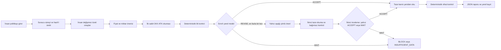
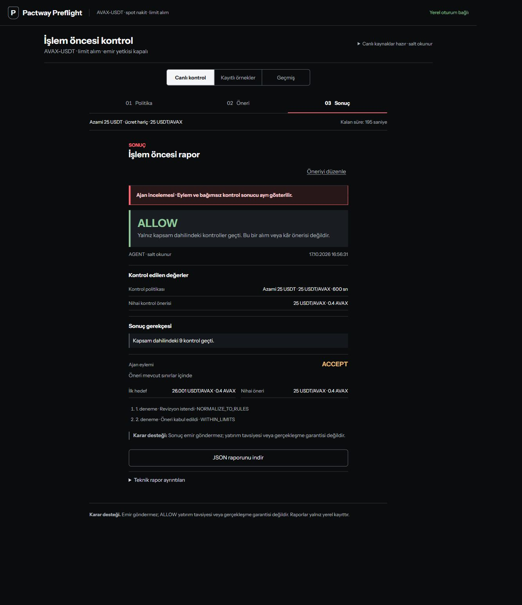
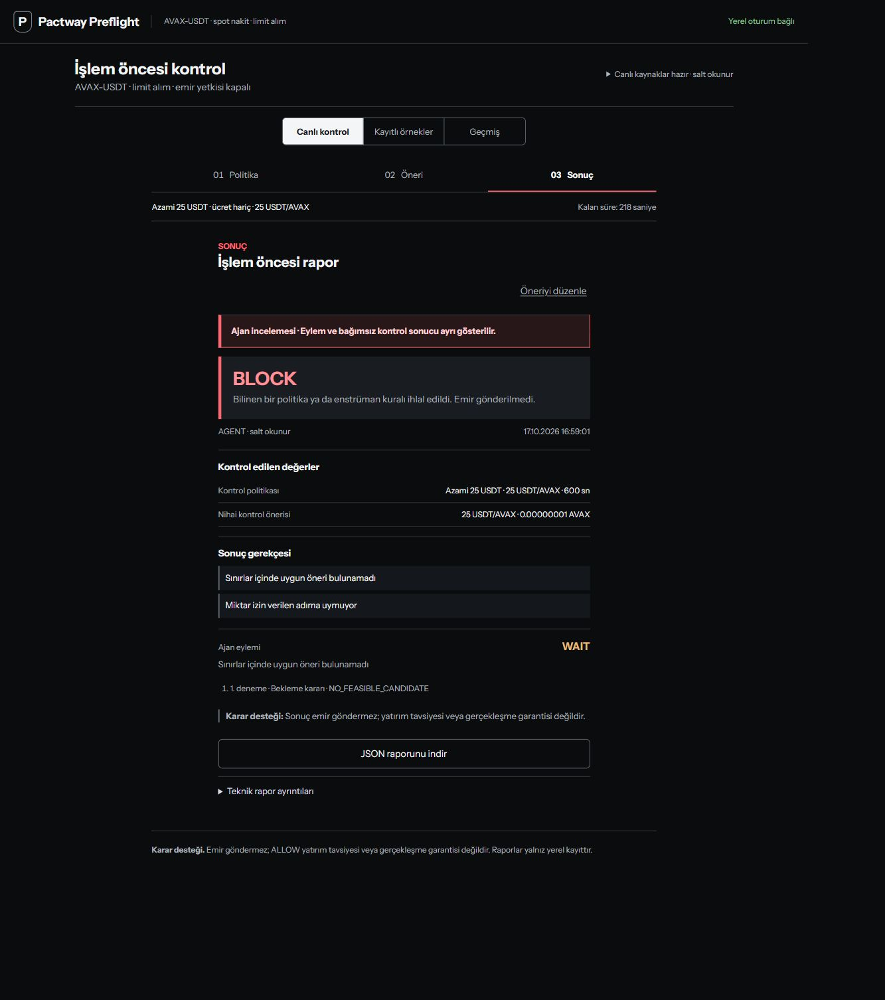
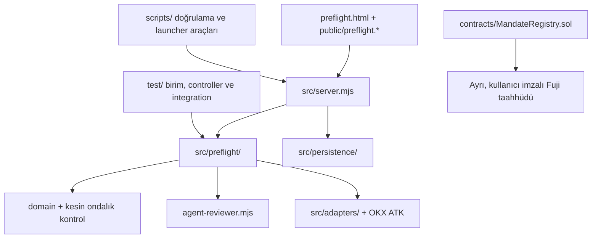

# Pactway Preflight

AI işlem ajanlarının tek bir emir önerisini, emir borsaya gönderilmeden önce, insanın onayladığı değişmez sınırlar ve taze salt-okunur piyasa kanıtı ile denetleyen yerel bir preflight aracıdır.

> Pactway emir göndermez. `ALLOW` yatırım tavsiyesi, kâr vaadi, bakiye yeterliliği veya borsanın emri kabul edeceği garantisi değildir.

## Bir bakışta

| Soru | Yanıt |
| --- | --- |
| Hangi problemi çözüyor? | Bir ajanın önerisi ile operatörün onayladığı sınırlar arasındaki farkı, emir öncesinde görünür ve tekrar doğrulanabilir hale getiriyor. |
| Hedef kullanıcı | AI trading ajanı geliştiren ekip, teknik operatör ve risk/safety değerlendiricisi. |
| Güncel kapsam | Yalnız `AVAX-USDT`, spot cash, limit alım. |
| Ajan ne yapabilir? | Kanıtı ve bağımsız kontrolü okuyup `ACCEPT`, tek aşağı yönlü `REVISE` veya `WAIT` seçebilir. |
| Ajan ne yapamaz? | Araç seçemez, argüman kuramaz, politika değiştiremez, fiyat/miktar artıramaz veya emir gönderemez. |
| Son sözü kim söyler? | Model değil; kesin ondalıklarla çalışan deterministik kontrol katmanı. |
| Çıktı | `ALLOW`, `BLOCK` veya `INSUFFICIENT_DATA` ve taşınabilir JSON raporu. |
| Çalışma biçimi | Stable Vercel root, operatörün PC'sindeki davetli tam canlı uygulamaya giriş/redirect noktasıdır; backend ve model PC'de kalır. |
| Ücret | Yerel model için API ücreti yoktur; hesaplama kullanıcının kendi donanımında yapılır. |

## Problem

Bir modelin “uygun görünüyor” demesi, önerinin onaylı fiyat, bedel ve borsa adımı kurallarına gerçekten uyduğu anlamına gelmez. Üstelik modelin girdiyi nasıl değiştirdiği, hangi piyasa verisini gördüğü ve sonuçtan kimin sorumlu olduğu kolayca bulanıklaşabilir.

Pactway üç soruyu birbirinden ayırır:

1. İnsan hangi sınırları onayladı?
2. Ajan ilk öneride neyi değiştirdi veya neden bekledi?
3. Bağımsız kurallar nihai öneri için hangi sonucu üretti?

Bu ayrım, “otonom strateji” iddiası yerine denetlenebilir ve sınırlı bir agentic katılım sunmayı hedefler. Bunun operasyonel güveni veya hata oranını artırdığı henüz kullanıcı çalışmalarıyla doğrulanmış değildir; ürün hipotezi budur.

## Özgün yaklaşım

- Modelin karar alanı geniş değil, bilinçli olarak dardır.
- Piyasa okuması ile emir yazma yetkisi aynı bağlantıda birleştirilmez.
- Model öneriyi serbestçe yeniden yazmaz; sunucunun türettiği `suggestedCandidate` değerini ancak izin verilen durumda aynen kabul edebilir.
- Nihai sonuç model metninden değil, aynı kanıt üzerinde yeniden çalışan bağımsız kontrolden gelir.
- İlk öneri, son öneri, model eylemi, kural gerekçeleri ve hash bağları ayrı kaydedilir.
- Eksik, eski veya çelişkili kanıt başarıya çevrilmez; sistem fail-closed davranır.

## Nasıl çalışır?



### 1. Politika

Operatör en yüksek emir bedelini, en yüksek birim fiyatı ve 60–3600 saniyelik süreyi girer. Kapsam `AVAX-USDT / buy / cash / limit` olarak sabittir. Süre taslak oluşturulurken başlar; onaydan sonra politika değiştirilmez veya otomatik uzatılmaz.

### 2. Salt-okunur kanıt

Preflight yolu OKX ATK üzerinden yalnız iki sabit çağrı yapar:

- `market_get_ticker({ instId: "AVAX-USDT", demo: true })`
- `market_get_instruments({ instType: "SPOT", instId: "AVAX-USDT", demo: true })`

Araç adları, argümanlar, sıra ve kapsam sunucu kodundadır; model bunları üretmez. Ticker referans fiyatı ile tick/lot/minimum/maksimum enstrüman kuralları tazelik, oturum bağı ve kaynak hash'leriyle kontrol edilir.

### 3. Gerçek agentic katılımın sınırı

Yerel model ilk bağımsız raporu görür. `ALLOW` ise yalnız `ACCEPT`; güvenilir kanıt yoksa yalnız `WAIT` dönebilir. `BLOCK` düzeltilebilir ise sunucu `revisionFeasible` ve aşağı yuvarlanmış `suggestedCandidate` üretir. Model ilk çağrıda bu adayı aynen `REVISE` edebilir; ikinci çağrı hiçbir koşulda yeni revizyon yapamaz.

Modelin keyfi strateji kurması, yeni parite seçmesi, miktarı veya fiyatı artırması, araç çağırması, URL/ağ erişimi istemesi ve emir göndermesi sözleşme dışıdır. Geçersiz model çıktısı fail-closed ele alınır; gizli cloud veya fixture fallback yoktur.

### 4. Bağımsız sonuç

Model eyleminden sonra piyasa ve enstrüman kanıtı yeniden okunur. Nihai kontrol; kapsam, süre, fiyat sınırı, bedel sınırı, fiyat adımı, miktar adımı, minimum/maksimum miktar, kanıt tazeliği ve bağlarını kesin ondalıklarla tekrar hesaplar.

## Canlı kabul örnekleri

17 Ekim 2026 tarihli yerel operatör kabulünde gerçek yerel model ve UID eşleşmiş, salt-okunur OKX TR demo bağlantısı kullanıldı. Bunlar performans ölçümü veya finansal başarı iddiası değil, üç kontrol dalının davranış kanıtıdır.

| İlk öneri | Ajan eylemi | Nihai öneri | Bağımsız sonuç |
| --- | --- | --- | --- |
| `25 USDT/AVAX × 0.4 AVAX` | `ACCEPT` | Değişmedi | `ALLOW` |
| `26.001 USDT/AVAX × 0.4 AVAX` | Bir kez `REVISE` | `25 USDT/AVAX × 0.4 AVAX` | `ALLOW` |
| `25 USDT/AVAX × 0.00000001 AVAX` | `WAIT` | Uygun aday yok | `BLOCK` |





## Davetli canlı demo ve operatör yolu

| Stable Vercel giriş noktası | Bilgisayarda çalışan canlı uygulama |
| --- | --- |
| `https://pactway-preflight-demo.vercel.app/` sabit bağlantısı güncel PC oturumuna yönlenir | Geçici HTTPS tüneli arkasında yerel `preflight.html` + Node.js backend |
| Vercel yalnız giriş/redirect katmanıdır; backend Vercel'de host edilmez | Politika, taze kanıt, yerel model ve canlı rapor akışı |
| Davet kodu yalnızca jüriye özel kanaldan verilir; repoya veya URL'ye konmaz | Loopback API, yerel oturum ve ortak operatör makinesi |
| Public web katmanı OKX/Ollama credential'ı taşımaz | Özel terminalde salt-okunur OKX ve yerel Ollama |
| Cüzdan, imza ve Fuji yayını yok | Varsayılan çıktı yine `LOCAL_ONLY` |
| Emir gönderemez | Emir gönderemez |

Bu, Vercel üzerinde çalışan bir SaaS veya sürekli açık public backend değildir. Stable root, operatörün PC'sinde başlatılan davetli tam uygulamaya giriş noktasıdır; bilgisayar, internet, Ollama, Node başlatıcısı ve `cloudflared` terminal süreci açık kalmalıdır. Davet kodu yalnız özel olarak paylaşılır; GitHub'a, Vercel ayarlarına, repoya veya URL'ye yazılmaz. Son kullanıcıdan Remix, cüzdan veya borsa hesabı bağlaması istenmez.

**Stable giriş:** [pactway-preflight-demo.vercel.app](https://pactway-preflight-demo.vercel.app/). Canlı oturumun geçici HTTPS origin'i başlatıcı terminalinde gösterilir; stable root bu güncel origin'e yönlendirilir. Bu nedenle başlatıcı veya bilgisayar yeniden başlarsa origin ve davet kodu değişebilir ve Vercel redirect hedefinin yeni origin'e güncellenmesi gerekir. Bu hackathon paylaşımı 24/7 çalışma veya production SLA taahhüt etmez.

### Jüri için erişim yönergesi

1. [Stable giriş](https://pactway-preflight-demo.vercel.app/) bağlantısını açın. Bağlantı, operatörün o anda açık tuttuğu bilgisayardaki canlı uygulamaya yönlenir.
2. Sunum ekibinden güncel davet kodunu özel kanaldan alın. Kod repoda, URL'de veya sayfa kaynaklarında bulunmaz ve yalnızca ilgili terminal oturumu açıkken geçerlidir.
3. Sayfadaki **Davet kodu** alanına kodu yazıp **Davetle aç** düğmesine basın. Kod çalışmıyorsa yeni kod istemek yerine API anahtarı, cüzdan parolası veya kurtarma kelimesi girmeyin.
4. Oturum açıldıktan sonra politika sınırlarını ve tek AVAX-USDT adayını girin. Uygulama OKX TR'den salt-okunur piyasa kanıtı alır, yerel modeli yalnız yorumlayıcı olarak kullanır ve emir göndermez.
5. Sonuç ekranındaki `ALLOW`, `BLOCK` veya `INSUFFICIENT_DATA` kararını ve taşınabilir raporu inceleyin. `ALLOW` emir onayı, yatırım tavsiyesi veya gerçekleşme garantisi değildir.

Ziyaretçinin Remix, cüzdan, OKX hesabı veya API anahtarı bağlaması gerekmez. Ekranda `Davet kodu gerekli`, `401` veya bağlantı hatası görülürse operatörün terminali, bilgisayarı, Ollama modeli ve internet bağlantısı kontrol edilmelidir; kullanıcıdan gizli anahtar istenmemelidir.

**Kaynak kodu:** [github.com/uguredgf/pactway-preflight](https://github.com/uguredgf/pactway-preflight)

## Sonuçların anlamı

- `ALLOW`: Yalnız kapsam dahilindeki kontroller geçti.
- `BLOCK`: Bilinen bir politika veya enstrüman kuralı ihlal edildi.
- `INSUFFICIENT_DATA`: Güvenilir/taze kanıt yok ya da kontrol tamamlanamadı.

Emir bedeli `fiyat × miktar` olarak değerlendirilir ve politika sınırı **ücret hariçtir**. Ücret, bakiye, portföy dağılımı, borsanın USD notional limiti, fiyat bandı, likidite, slippage, emir kabulü ve gerçekleşme kapsam dışıdır. USDT sessizce USD sayılmaz. Ticker adil fiyat veya yeterli likidite kanıtı değildir.

Bu servis başka bir yürütücüyü teknik olarak durdurmaz. Üretim emri öncesinde hesap, ücret, bakiye, borsa kuralları ve yürütme yetkileri ayrı doğrulanmalıdır.

## Avalanche Fuji: bir rapor için dış taahhüt

Uygulamanın normal raporları `LOCAL_ONLY` kalır. Canlı kabuldeki **tek bir** Preflight raporunun politika ve rapor hash'leri, operatörün ayrı Core imzalarıyla Avalanche Fuji MandateRegistry kontratına kaydedildi. UI, web sitesi ve backend Avalanche üzerinde host edilmez; otomatik zincir yayını yoktur.

- Ağ: Avalanche Fuji C-Chain, chain ID `43113`
- Kontrat: [`0xd2f8…436b`](https://repo.sourcify.dev/43113/0xd2f8b2164C9843C2Eb15DfEd696d230427Eb436B/)
- `commitPolicy`: `0xa303dc8b2745144eb998be7064b49a14388bb9848386ad706a116ea8bf2a8eae`, blok `59602823`
- `appendDecision`: `0x6114d998b958fc1f1b83e1b5ffa7b2ba543a381974d4acb951fda77c2e2b8eaf`, blok `59603314`
- Son durum: sequence `1`; kayıtlı receipt hash, rapor hash'i ile eşleşti

İşlemler Fuji RPC üzerinden başarılı receipt, canonical blok, sıfır değer, calldata ve event bağıyla doğrulandı. Doğrulanmış bir resmi explorer deep-link biçimi bulunmadığı için işlem hash'leri tahmini URL'lere bağlanmadı. Bu kayıt CEX emrini, gerçekleşmeyi, model kalitesini veya rapor içeriğinin ekonomik doğruluğunu kanıtlamaz.

## Kurulum

Gereksinimler: Node.js `22.13+`, npm ve canlı ajan yolu için yerel Ollama/Qwen3.

```powershell
npm ci
npm start
```

Credential olmadan `http://localhost:8766` açılır; kayıtlı örnekler kullanılabilir, canlı kontrol kapalı kalır. Yerel model API ücreti oluşturmaz ancak CPU/GPU, bellek ve elektrik maliyeti kullanıcının donanımına aittir.

UID eşleşmiş salt-okunur canlı demo için ayrı bir özel terminalde:

```powershell
node scripts/connect-preflight-agent.mjs
```

Başlatıcı demo/salt-okuma bilgilerini terminalde ister ve `127.0.0.1:18783` üzerinde çalışır. Credential değerlerini sohbete, tarayıcı formuna, `.env` dosyasına, rapora veya repoya yazmayın. Kaynak değişiklikleri çalışan Node sürecine hot reload olmaz.

### Bilgisayardan davetli canlı paylaşım

Tam akışı uzaktan göstermek için ayrı bir oturum başlatıcısı vardır:

```powershell
node scripts/connect-preflight-shared.mjs
```

Bu yol, yerel Ollama ve resmi `cloudflared` kurulumu gerektirir. UID ve salt-okuma demo bilgileri yalnız operatörün özel terminaline girilir. Başlatıcı ayrı veritabanı ve loopback portu kullanır, geçici HTTPS adresi açar ve terminalde bir davet kodu gösterir. Ziyaretçi yalnız bu kodla oturum açar; kendi politika sınırlarını ve adayını girer. Borsa anahtarı veya cüzdan istemez. Mevcut `18783` oturumu ve kayıtları paylaşılmaz.

Bu, operatörün piyasa bağlantısını kullanan kontrollü hackathon demosudur. Her ziyaretçinin kayıtları ayrıdır fakat borsa bağlantısı ve GPU ortaktır. Kontroller tek tek çalışır. Bilgisayar, internet, Ollama, başlatıcı veya tünel kapanırsa canlı bağlantı çalışmaz. Yeniden başlatmada HTTPS adresi ve davet kodu değişebilir; stable Vercel root'un redirect hedefi de güncellenmelidir. Bu akış sürekli açık hizmet veya production SLA değildir.

## Doğrulama

```powershell
npm test
node --test --test-concurrency=1 test/integration/*.test.mjs
npm audit
node scripts/verify-preflight-report.mjs "C:\path\preflight-report.json"
```

Rapor doğrulayıcı sabit kurallarla sonucu ve hash bağlarını yeniden hesaplar. Yerel hash tek başına dijital imza veya bağımsız veri kaynağı kanıtı değildir. Integration kümesi loopback süreçleri ve opt-in dış okumalar içerir; hiçbir test emir veya zincir işlemi göndermez.

## Repo haritası



## Güvenlik sınırları

- Üretime hazır bir trading sistemi değildir.
- Borsa yazma, iptal ve transfer yolu Preflight akışında yoktur.
- Sunucu yalnız loopback üzerinde dinler. İsteğe bağlı davetli paylaşım, ayrı oturumu HTTPS tüneli üzerinden açar; eski yönetim ve işlem uçları bu modda kapalıdır.
- CSRF, oturum bağı, UUID idempotency ve kayıp yanıt kurtarma kontrolleri vardır.
- Eski/eksik/uyumsuz kanıt `ALLOW` üretmez.
- Belirsiz istekte yeni kontrol başlatmak yerine aynı istek sonucu uzlaştırılır.
- Model çağrısı başarısız olduğunda ekonomik kural sonucu gevşetilmez.
- Public release'e credential, yerel journal, tam rapor veya yayın manifesti konmaz.

## Yol haritası — henüz yapılmadı

- Kapsamı yeni parite veya emir türlerine açmadan önce ayrı politika şemaları tasarlamak.
- Bağımsız kullanıcı çalışmalarıyla anlaşılabilirlik ve hata önleme hipotezini ölçmek.
- Çok kullanıcılı kimlik, secret yönetimi ve izolasyon modeli geliştirmek.
- Hesap/bakiye/ücret kanıtını Preflight kararına güvenli biçimde dahil etmek.
- Harici yürütücüler için kriptografik zorunlu kapı ve açık entegrasyon sözleşmesi kurmak.
- Zincir taahhüdünü ancak açık kullanıcı onayı ve receipt doğrulamasıyla ürünleştirmek.

Bu maddeler mevcut özellik, kabul sonucu veya teslim taahhüdü değildir.

## Ana belgeler

- [Ürün kapsamı ve değişmezler](docs/PREFLIGHT-KAPSAM.md)
- [Kullanım, sonuçlar ve demo akışı](docs/PREFLIGHT-KULLANIM.md)
- [HTTP API sözleşmesi](docs/PREFLIGHT-API.md)
- [Ürün adı ve konumlandırma](docs/URUN-ADI.md)

## Lisans ve durum

Bu repo hackathon/MVP değerlendirmesi için geliştirilmiştir. `package.json` içinde genel bir açık kaynak lisansı ilan edilmemiştir. Kullanım veya yeniden dağıtım için depo sahibinden izin alınmalıdır.
